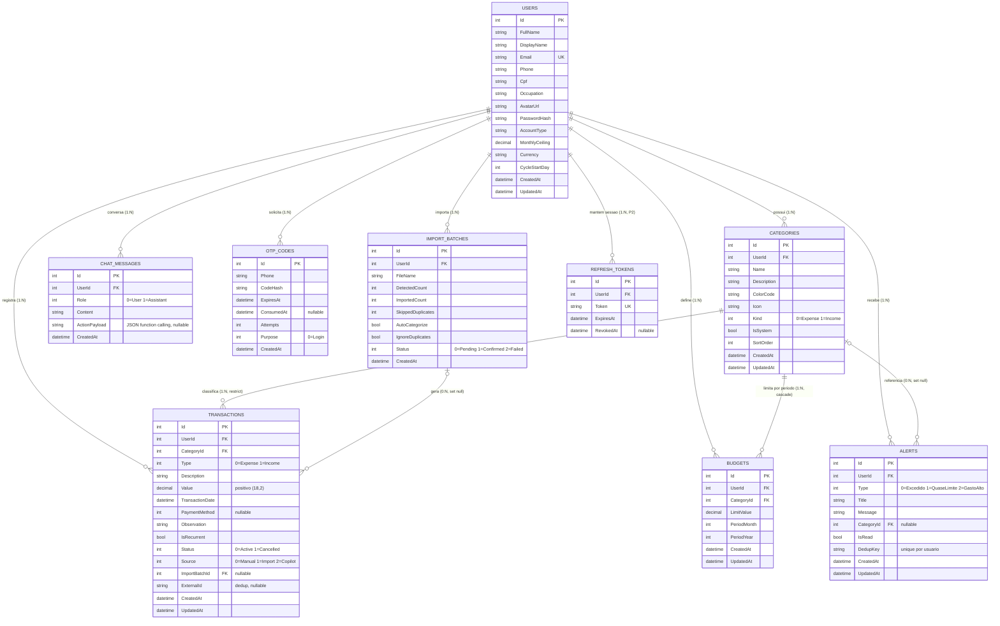

# Diagrama Entidade-Relacionamento — ConektaFinance (PIM IV)

> Entregável da Etapa 3 (`03_MODELO_DADOS.md`). Diagrama em **Mermaid** (`erDiagram`) — renderiza nativamente no GitHub/GitLab.
> Convenções: PK = chave primária, FK = chave estrangeira. Todos os dados de negócio têm `UserId` (ownership por usuário).

## Chaves únicas compostas

| Tabela | Colunas | Objetivo |
|---|---|---|
| Categories | (UserId, Name) | sem duplicidade de nome por usuário |
| Budgets | (UserId, CategoryId, PeriodMonth, PeriodYear) | upsert de teto por período |
| Alerts | (UserId, DedupKey) | um alerta por categoria/tipo/mês |
| Transactions | (UserId, ExternalId) | dedup de importação (quando presente) |
| Users | (Email) | login único |
